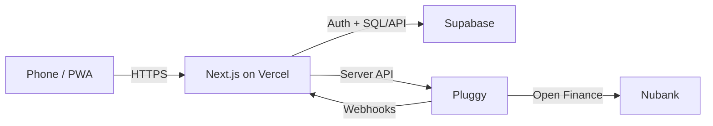
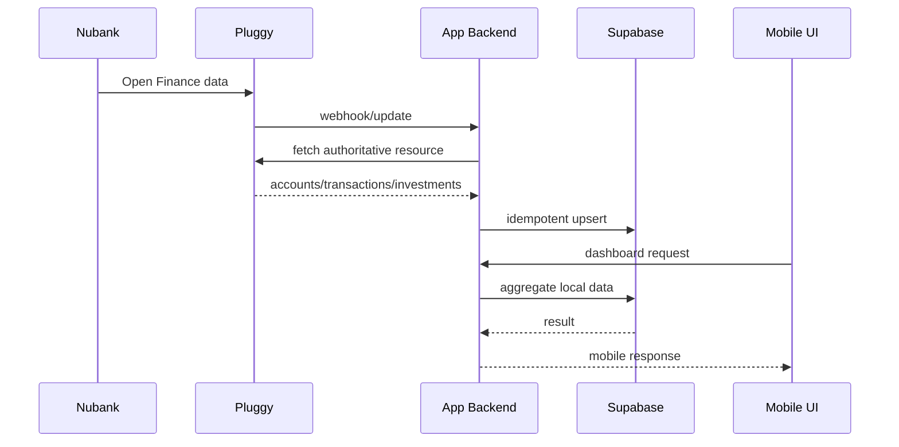

# Minimal Architecture

## System

## Why this architecture

It is intentionally boring:

- Next.js = UI + server routes;
- Supabase = auth + database;
- Pluggy = bank/Open Finance abstraction;
- Vercel = deployment.

No additional infrastructure until a measured problem requires it.

## Runtime data flow

## Modules

- `auth`
- `integrations/pluggy`
- `finance`
- `investments`
- `tax`
- `dashboard`
- `repositories`

## Non-goals

No:
- distributed queue initially;
- separate tax service;
- event bus;
- data warehouse;
- live trading;
- live payment initiation.

If webhook processing later exceeds the safe function lifecycle, introduce a durable queue as an explicit architecture decision.
